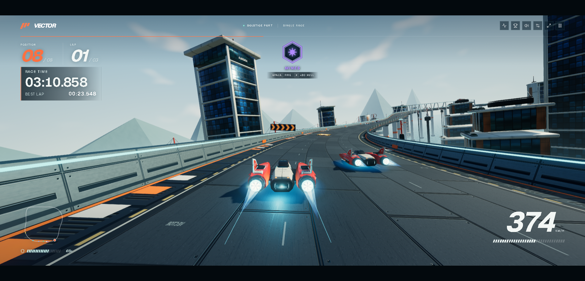

# VECTOR: ANTI-GRAVITY RACING — offline mirror

Full mirror of **VECTOR: ANTI-GRAVITY RACING** on the Wavedash platform
(https://wavedash.com/games/vector-anti-gravity-racing).

Source: https://wavedash.com/games/vector-anti-gravity-racing



## Stack

- **Vite production bundle** — `index.html` loads the entry chunk
  `assets/index-DphGw8Ou.js` (React runtime + React-Aria UI vendors, the app's
  music/track/ship tables, the bundled three.js WebGPU + TSL engine, the app UI)
- **WebGPU renderer** — three.js `WebGPURenderer` with a WebGL2 backend
  fallback; the game reports `WEBGPU` in its own footer; scenery and ships are
  glTF kits/textures loaded from `models/` and `environment/`
- **Wavedash platform shell** — the game is delivered inside the platform's
  embed (`embed` / `embed.js` / `embed.css` / `sw-embed.js`), which mints the
  per-session gameplay JWT the build host's files need; the mirror carries those
  shell files at the paths the game requests
- **Async scenery chunks** — `game-CsnOSIff.js` (race simulation),
  `player-Cd-Kznkt.js` (intro/garage scene), `renderer-setup--EktvnNe.js` +
  `award-scene-D9Dc5ufv.js` (scenery), `HDRLoader-C77IBAVq.js` (vendored
  three.js HDR loaders), `audio-preparation.worker-CEAJS9BC.js` (procedural
  audio worker), `client-BtP_tmtQ.js` (Wavedash SDK client shim)

## What this is

VECTOR: ANTI-GRAVITY RACING — "Race above Solstice Port in VECTOR. A WebGPU
anti-gravity racer with online multiplayer, airbrakes, boost, and controller
support": five circuits (Solstice Port MK III, Nocturne Exchange, Sirocco
Oasis, Shackleton Rim, Meridian Grand Prix), five ships with livery variants,
weapons (mines/rockets/missile/cannon), a career/medal ladder and a 19-track
music library. The game page is a SvelteKit platform shell whose GamePlayer
iframe boots the per-build CDN host
`<gameCloudId>-<user-hash>-<build-hash>.builds.wavedashcdn.com` (captured build
`VECTOR 1.7`, buildNumber 95, engine `CUSTOM`, entrypoint `index.html`);
captured whole: the entry shell, every JS chunk, the tileable scenery/ship
payloads, HDRIs, music and award art — 86 files, ~165 MiB.

External: the platform backend only — `convex-api.wavedash.com` (lobbies/cloud
saves), `uploads.wavedash.com` / `ugc.wavedashcdn.com` (storage), Sentry
telemetry and Google sign-in chrome on the platform page. The game itself runs
without them (verified on loopback: races at Solstice Port render and drive
from the mirror alone); `/vector/preferences-v1.json` and
`/vector/progress-v1.json` are Wavedash userfs cloud-save paths served by that
backend, recorded as gaps in `_mirror-report.json`.

## Layout

- `.upstream/manifest.json` — sha256 for every captured file
- `docs/cover.png` — cover: racing through a banked corner at Solstice Port
  (live platform session)
- `docs/boot-2026-10-13.png` — boot evidence: the mirror's main menu, served on
  loopback
- `docs/serve-probe-2026-10-13.png` — serve-probe gameplay: the mirror racing
  at 461 km/h on loopback
- `docs/network-log-2026-10-13.jsonl` — the browser session's request log
  (page load → main menu → intro/garage asset set → full 3-lap race → finish)
- `readable/` — prettified derived layer (pinned prettier 3.9.6) for every
  captured JS/CSS file, plus the `embed` inline config block twin and
  `index-inline-map.json` (inline byte ranges + sha256)
- `src/` + `split-spec.json` — 158 statement-aligned slices with the recorded
  derivation spec (171 sections: 158 ranged + 8 wholeFile + 5 skipped-tail)
- `tools/capture.mjs` — reproducible fetch of the build closure (playKey →
  embed → gameplay JWT → every build file)
- `tools/derive.mjs` — rebuild `readable/` + `src/` + `split-spec.json`
- `tools/update.mjs` — read-only drift probe against the live platform
- `tools/verify.mjs` — re-hash the capture against the manifest
- `tools/audit.js` — integrity gate for the derived layers (`AUDIT PASS`)
- `tools/serve.mjs` — tiny static server for the boot test / local play

## Assets

- **models** — 25 file(s): `models/` — circuits (`solstice-port-kit.glb`,
  `nocturne-city-kit.glb`, `sirocco-oasis-kit.glb`, `shackleton-base-kit.glb`,
  six `meridian-*-kit.glb` + `meridian-materials.glb`), hub (`launch-bay.glb`),
  ships (`kestrel`, `manta`, `talon`, `monarch`, `vesper` -player.glb + the
  `kestrel-wavedash` / `manta-claude` liveries), weapons
  (`mines/rockets/missile/cannon.glb`), props (`port-life.glb`), awards
  (`awards.glb`), `previews/` (7 ship/livery JPGs)
- **environment** — 11 file(s): `environment/` (three 1k HDRIs — Docklands 02,
  Launch Bay, Shanghai Bund — plus the lunar sky set: `lunar-earth*`,
  `lunar-milky-way*`, `regolith-detail*` PNGs)
- **audio** — 20 file(s): `audio/` (19 music tracks — `vector-race`,
  `menu-groove`, `neon-undertow`, the `metallic-dropouts` takes, … — and the
  intro theme `intro-vector.mp3`)
- **ui** — 6 file(s): `ui/awards/` (`medal` / `trophy` × gold/silver/bronze WebP)
- **fonts** — 2 file(s): `assets/` (Geist + Geist Mono WOFF2 subsets)

## Run

Serve the repo root with any static file server — the capture is a static site
(no build step) laid out as the build host served it, so the game's requests
resolve 1:1:

```
node tools/serve.mjs . 8137
# then open http://127.0.0.1:8137/
```

Notes: the platform SDK is absent on loopback, so platform features (online
lobby, cloud saves) no-op; single races, the garage and the career ladder run
from local files. The build host serves the text assets brotli-compressed —
the mirror stores the content-decoded bytes exactly as a browser receives them,
so a naive static server serves everything correctly as identity (nothing needs
re-encoding).

## Verify

```
node tools/verify.mjs     # re-hash the capture against the manifest
node tools/audit.js       # derived-layer integrity gate (AUDIT PASS)
node tools/check-exports.mjs   # the derived layer still exports every public name
node tools/derive.mjs --check          # the derived layer is current? (compares a fresh rebuild; writes NOTHING)
node tools/check-links.mjs             # every export table names a binding the layer declares
```

### Export-surface coverage

`tools/check-exports.mjs` reports **7 export table(s) checked** and **no public
export name lost** — one row for every export table the capture ships: the five
app chunks checked through their recorded pretty twins, and the two vendor
chunks checked capture-to-pretty. Its two `NOT covered` rows are the export
tables inside the *reading copies*
`readable/assets__HDRLoader-C77IBAVq.pretty.js` and
`readable/assets__client-BtP_tmtQ.pretty.js`. Each is the same statement as the
served chunk's table, which the gate already compares through the whole-file
section's recorded `origin` (`wholefile:assets/HDRLoader-C77IBAVq.js`,
`wholefile:assets/client-BtP_tmtQ.js`); the only possible counterpart for a
reading copy is the file itself, which the gate correctly refuses to count as a
check. Both chunks are load-bearing — `HDRLoader-C77IBAVq.js` is imported by
`renderer-setup--EktvnNe.js`, `award-scene-D9Dc5ufv.js`, `player-Cd-Kznkt.js`
and `game-CsnOSIff.js`, and `client-BtP_tmtQ.js` is dynamically imported by the
entry chunk (`await import("./client-BtP_tmtQ.js")`, default export) — and a
rename on either side turns the gate red, naming the file and the lost name.
Both vendor chunks are whole-file by policy and are never sliced, so no third
derived text exists to compare the reading copy against: no spec change can
raise `checked` without manufacturing a self-compare. The two rows stay
honestly uncovered; the capture-side names are covered.

## Updating from upstream

```
node tools/update.mjs     # read-only drift probe: what changed upstream
```

The probe boots the same platform session a browser would (SSR page → playKey →
embed shell → gameplay JWT), derives the per-build CDN host, and compares every
manifest file against the live bytes. It never rewrites the capture — a mirror
is a point-in-time snapshot. Refreshing means re-running `node tools/capture.mjs`
into a clean tree (or copying replaced files to `legacy/<date>/` first, PLAN §3)
and re-cutting `readable/` + `src/` on top of the new build.

### 2026-10-13 capture + derivation

- **Platform mechanics** — the game is served by a per-build CDN host
  (`mx70fsjxynf8mke9yqthamtfcx8dtssc-<user-hash>-1c1257d5.builds.wavedashcdn.com`),
  not by wavedash.com. The platform page server-renders the game bootstrap
  (playKey, gameCloud, gameBuild, anonymous user); `GET /embed?…&pk=<playKey>`
  answers the embed shell carrying the gameplay JWT; every build-file request
  then travels with `Authorization: Bearer <jwt>` + `X-Wd-Sw: jwt`. The capture
  is anonymous-JWT throughout.
- **Closure** — network-log-led to fixpoint: the browser session log
  (load → menu → intro/garage asset set → full 3-lap race → finish) plus the
  game's embedded tables (five-circuit table `vJ`, the scenery→kit map, the
  music library, the ship table `Xu`, the lunar/award texture set) form the
  candidate universe; every candidate was probed and nothing referenced is
  missing (86 files, 172,916,186 bytes). Only `favicon.ico` is 404 (browsers
  request it; the build ships `favicon.svg`). Two runtime paths
  (`/vector/preferences-v1.json`, `/vector/progress-v1.json`) are platform
  userfs cloud saves, recorded as backend gaps, not static assets.
- **readable/** — pinned prettier 3.9.6, module API only (never the CLI: it
  respects `.gitignore` and can silently echo its input), default options,
  formatted to a fixed point; the entry chunk converges on pass 2 (prettier's
  first pass on that 1.5 MB input is not yet a fixed point of the same call),
  everything else on pass 1 — the per-file pass count is recorded in
  `split-spec.json` and replayed by the audit. 13 pretties
  (11 `*.pretty.js` + 2 `*.pretty.css`), 194,154 lines; every pretty is
  provably not a byte copy of its capture source and re-renders byte-exact.
- **src/** — 158 statement-aligned slices (65,081 lines) across 7 files; exact
  2-line provenance header (`// <tag> NN — <marker>` +
  `// Lines A-B of <readable> (statement-aligned).`); cuts land only on
  top-level declaration boundaries (~250-350 line windows; the largest slice is
  4,446 lines — an oversized merged declaration kept whole). 158/158 parse
  standalone under `node --input-type=module --check -` and round-trip
  byte-exact to their readable line ranges; the 17 relative imports across
  slices all resolve inside the capture and every named import exists in the
  target's export table (the chunks' minified `export{local as public}` tables
  are parsed in that shape by `tools/audit.js`).
- **Vendor rule** — wholeFile, never sliced: `embed.js` (Wavedash platform SDK),
  `sw-embed.js` (its embed service worker), `assets/HDRLoader-C77IBAVq.js`
  (vendored three.js HDR loaders) and `assets/client-BtP_tmtQ.js` (SDK client
  shim); stylesheets `assets/index-J7X__Wjw.css` and `embed.css`. Inside the
  entry chunk two content-anchored wholeFile regions are guarded and asserted:
  the React + React-Aria UI runtime head and the bundled three.js WebGPU + TSL
  engine region (ending at the app's track-spline builder). Each chunk's final
  pure `export {…}` table is a skipped section (5 total). Every payload under
  `models/`, `environment/`, `audio/`, `ui/` and the fonts is recorded
  `notRendered` with size + sha256 (72 entries) — never prettified or re-encoded.
  Honest limitation: the race-simulation and scenery chunks carry
  bundler-merged three.js/TSL utility code interleaved with app code at
  minified module boundaries, so those files are sliced statement-aligned and
  their slices are not claimed as clean app code.
- **Gates** — `node tools/verify.mjs` → `86 files checked, 0 problems`;
  `node tools/audit.js` → `AUDIT PASS` (171 sections, 158/158 round-trips,
  13/13 pretties re-render byte-exact, 13/13 provably distinct, 17/17 imports
  resolve); `node tools/update.mjs` → `up to date: 86 captured files identical
  upstream (build 1c1257d5)`; serve probe — the mirror served on loopback,
  booted to the main menu and raced (461 km/h, `docs/serve-probe-2026-10-13.png`),
  listener killed, port closed (netstat). Rebuild derived layers with
  `node tools/derive.mjs`.
- **§0.4 fork-over-mirror checked 2026-10-13** — the game is closed-source: the
  platform page links only platform chrome (a generic `/developers` nav entry),
  and the game's own JS/credits name the music artist (`superpositionuk`), the
  in-game sponsor liveries (Anthropic/Claude) and vendored library issue links
  (three.js, Sentry) — no project source repository exists to fork, so the
  mirror stands.

## Mirror conventions

- **Capture layer** — the captured files are byte-exact copies of what the
  origin's build host served (content-decoded, as a browser receives them);
  nothing in them is edited.
- **Readable layer** — `readable/` is derived (prettified) and never shipped to
  a browser; it exists so the bundles can actually be read.
- **Provenance** — `.upstream/manifest.json` records sha256 for each captured
  artifact, and `tools/verify.mjs` re-checks it.
- **Drift** — `tools/update.mjs` is read-only: it reports what changed upstream
  and never rewrites the capture.
- **Derived layers** — `readable/` and `src/` are re-cut from the capture after
  every refresh; they never enter the capture sums.

## Fleet status

<!-- mirror-status:start — feeds _standard/REPO-INDEX.md. Update ONLY your own mirror's block; never edit the shared index (PLAN §8). Rebuild: node _standard/build-index.mjs -->
<!-- cols: cls=classification · ver=verify 0 problems · upd=drift probe · man=manifest · rdbl=readable re-derived · src=reversed src · boot=boot test · top=offline-mirror topic · tag=backup tag · staged=staged not committed -->
| # | repo | cls | ver | upd | man | rdbl | src | boot | top | tag | staged |
|---|---|---|---|---|---|---|---|---|---|---|---|
| 313 | vector-anti-gravity-racing | mirror | ✓ | ✓ | ✓ | ✓ | ✓ | ✓ | ✓ | — | — |
<!-- mirror-status:end -->
