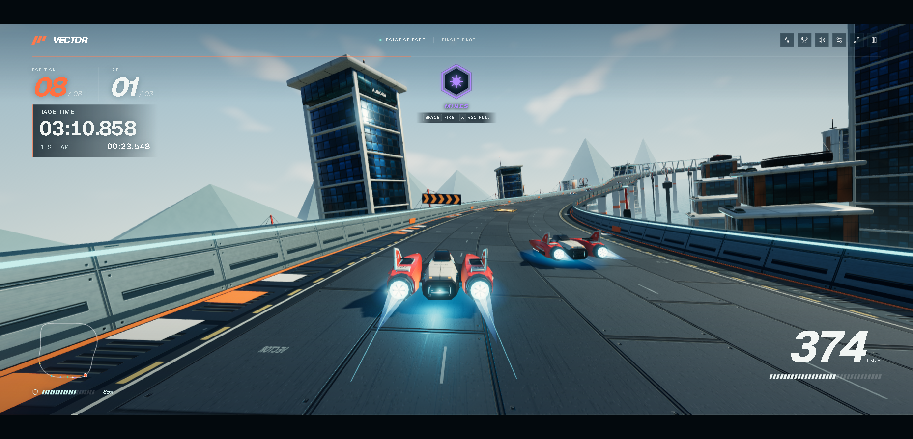

# VECTOR: ANTI-GRAVITY RACING — offline mirror

Full mirror of **VECTOR: ANTI-GRAVITY RACING** on the Wavedash platform
(https://wavedash.com/games/vector-anti-gravity-racing).

Source: https://wavedash.com/games/vector-anti-gravity-racing



## Stack

- **Vite production bundle** — `index.html` loads the entry chunk
  `assets/index-DF2rMRzV.js` (React runtime + React-Aria UI vendors, the app's
  music/track/ship tables, the bundled three.js WebGPU + TSL engine, the app UI)
- **WebGPU renderer** — three.js `WebGPURenderer` with a WebGL2 backend
  fallback; the game reports `WEBGPU` in its own footer when a WebGPU adapter is
  available and falls back to `WEBGL 2` under software rendering (as in the
  headless boot below); scenery and ships are glTF kits/textures loaded from
  `models/` and `environment/`
- **Wavedash platform shell** — the game is delivered inside the platform's
  embed (`embed` / `embed.js` / `embed.css` / `sw-embed.js`), which mints the
  per-session gameplay JWT the build host's files need; the mirror carries those
  shell files at the paths the game requests
- **Async scenery chunks** — `game-D43Oxqny.js` (race simulation),
  `player-D3Mk6s3d.js` (intro/garage scene), `renderer-setup-PQ27DzE4.js` +
  `award-scene-DZbn-o_G.js` (scenery), `HDRLoader-Bse-uZFj.js` (vendored
  three.js HDR loaders), `audio-preparation.worker-CEAJS9BC.js` (procedural
  audio worker), `client-BtP_tmtQ.js` (Wavedash SDK client shim)

## What this is

VECTOR: ANTI-GRAVITY RACING — "Race above Solstice Port in VECTOR. A WebGPU
anti-gravity racer with online multiplayer, airbrakes, boost, and controller
support": five circuits (Solstice Port MK III, Nocturne Exchange, Sirocco
Oasis, Shackleton Rim, Meridian Grand Prix), five ships with livery variants,
weapons (mines/rockets/missile/cannon), a career/medal ladder and a 19-track
music library. The game page is a SvelteKit platform shell whose GamePlayer
iframe boots the per-build CDN host
`<gameCloudId>-<user-hash>-<build-hash>.builds.wavedashcdn.com` (captured build
`VECTOR 1.13 playtest 3`, buildNumber 104, engine `CUSTOM`, entrypoint
`index.html`); captured whole: the entry shell, every JS chunk, the tileable
scenery/ship payloads, HDRIs, music and award art — 86 files, ~165 MiB.

External: the platform backend only — `convex-api.wavedash.com` (lobbies/cloud
saves), `uploads.wavedash.com` / `ugc.wavedashcdn.com` (storage), Sentry
telemetry and Google sign-in chrome on the platform page. The game itself runs
without them (verified on loopback: races at Solstice Port render and drive
from the mirror alone); `/vector/preferences-v1.json` and
`/vector/progress-v1.json` are Wavedash userfs cloud-save paths served by that
backend, recorded as gaps in `_mirror-report.json`.

## Layout

- `.upstream/manifest.json` — sha256 for every captured file
- `docs/cover.png` — cover: racing through a banked corner at Solstice Port
  (live platform session)
- `docs/boot-2026-10-13.png` — boot evidence: the mirror's main menu, served on
  loopback
- `docs/boot-2026-11-01-refresh.png` — boot evidence for the refreshed build
  (104): the main menu over a live Solstice Port scene, served on loopback with
  the network blocked
- `docs/serve-probe-2026-10-13.png` — serve-probe gameplay: the mirror racing
  at 461 km/h on loopback
- `docs/network-log-2026-10-13.jsonl` — the browser session's request log
  (page load → main menu → intro/garage asset set → full 3-lap race → finish)
- `legacy/2026-11-01/` — the replaced/rotated bytes from the build-95 capture
  (4 re-served shell files + 7 upstream-gone chunks) with `SHA256SUMS.txt` +
  `legacy.json`, plus the build-95 manifest
- `readable/` — prettified derived layer (pinned prettier 3.9.6) for every
  captured JS/CSS file, plus the `embed` inline config block twin and
  `index-inline-map.json` (inline byte ranges + sha256)
- `src/` + `split-spec.json` — 162 statement-aligned slices with the recorded
  derivation spec (175 sections: 162 ranged + 8 wholeFile + 5 skipped-tail)
- `tools/capture.mjs` — reproducible fetch of the build closure (SSR build
  reference + launch API playKey → embed → gameplay JWT → every build file;
  content-hashed `assets/` chunks discovered from `index.html`)
- `tools/derive.mjs` — rebuild `readable/` + `src/` + `split-spec.json`
- `tools/update.mjs` — read-only drift probe against the live platform
- `tools/verify.mjs` — re-hash the capture against the manifest
- `tools/audit.js` — integrity gate for the derived layers (`AUDIT PASS`)
- `tools/serve.mjs` — tiny static server for the boot test / local play

## Assets

- **models** — 25 file(s): `models/` — circuits (`solstice-port-kit.glb`,
  `nocturne-city-kit.glb`, `sirocco-oasis-kit.glb`, `shackleton-base-kit.glb`,
  six `meridian-*-kit.glb` + `meridian-materials.glb`), hub (`launch-bay.glb`),
  ships (`kestrel`, `manta`, `talon`, `monarch`, `vesper` -player.glb + the
  `kestrel-wavedash` / `manta-claude` liveries), weapons
  (`mines/rockets/missile/cannon.glb`), props (`port-life.glb`), awards
  (`awards.glb`), `previews/` (7 ship/livery JPGs)
- **environment** — 11 file(s): `environment/` (three 1k HDRIs — Docklands 02,
  Launch Bay, Shanghai Bund — plus the lunar sky set: `lunar-earth*`,
  `lunar-milky-way*`, `regolith-detail*` PNGs)
- **audio** — 20 file(s): `audio/` (19 music tracks — `vector-race`,
  `menu-groove`, `neon-undertow`, the `metallic-dropouts` takes, … — and the
  intro theme `intro-vector.mp3`)
- **ui** — 6 file(s): `ui/awards/` (`medal` / `trophy` × gold/silver/bronze WebP)
- **fonts** — 2 file(s): `assets/` (Geist + Geist Mono WOFF2 subsets)

## Run

Serve the repo root with any static file server — the capture is a static site
(no build step) laid out as the build host served it, so the game's requests
resolve 1:1:

```
node tools/serve.mjs . 8137
# then open http://127.0.0.1:8137/
```

Notes: the platform SDK is absent on loopback, so platform features (online
lobby, cloud saves) no-op; single races, the garage and the career ladder run
from local files. The build host serves the text assets brotli-compressed —
the mirror stores the content-decoded bytes exactly as a browser receives them,
so a naive static server serves everything correctly as identity (nothing needs
re-encoding).

## Boot test (2026-10-27)

- Entry: `http://127.0.0.1:5007/` served by `tools/serve.mjs` with the network
  blocked (`MAP * 127.0.0.1`).
- Outcome: **rendered** — the VECTOR main menu appeared over a live Solstice
  Port scene; one click on `ENTER RACE` launched a 3-lap single race with the
  in-race HUD (position 08/08, lap 01/03, race time running) and the Kestrel
  rendering on the track.
- Evidence: body 904 chars (menu) / 114 chars (in-race HUD); canvas 1262x540;
  0 console errors; 0 failed same-origin requests, 0 blocked cross-origin;
  screenshot `docs/boot-2026-10-27.png`.
- Gaps seen: none — the server logged 9 successful same-origin requests and no
  404s during boot and race entry.

The mirror's existing "playable build" claim is confirmed, not refuted: the
capture boots and races offline from local files alone.

## Boot test (2026-11-01, refreshed build 104)

- Entry: `http://127.0.0.1:4702/` (a free port probed with curl first) served by
  `tools/serve.mjs`; headless Chrome
  (`--host-resolver-rules="MAP * 127.0.0.1" --enable-unsafe-swiftshader
  --use-angle=swiftshader`, 1280x720) driven over CDP.
- Outcome: **rendered** — the refreshed build's main menu appeared over a live
  Solstice Port scene (Kestrel on the grid, `RACE SETUP` panel, footer
  `VECTOR 1.13 · WEBGL 2` — the software-rendering WebGL2 fallback, since the
  headless SwiftShader adapter exposes no WebGPU device).
- Evidence: body 376 chars; canvas 1262x540; title `VECTOR — Anti-Gravity
  Racing`; 0 console errors; 35 same-origin 200s and 0 404s in the server log;
  screenshot `docs/boot-2026-11-01-refresh.png`. Listener killed and the port
  verified closed (`netstat`).

The refreshed capture boots offline from local files alone; the earlier
"playable build" claim holds for build 104.

## Verify

```
node tools/verify.mjs     # re-hash the capture against the manifest
node tools/audit.js       # derived-layer integrity gate (AUDIT PASS)
node tools/check-exports.mjs   # the derived layer still exports every public name
node tools/derive.mjs --check          # the derived layer is current? (compares a fresh rebuild; writes NOTHING)
node tools/check-links.mjs             # every export table names a binding the layer declares
```

### Export-surface coverage

`tools/check-exports.mjs` reports **7 export table(s) checked** and **no public
export name lost** — one row for every export table the capture ships: the five
app chunks checked through their recorded pretty twins, and the two vendor
chunks checked capture-to-pretty. Its two `NOT covered` rows are the export
tables inside the *reading copies*
`readable/assets__HDRLoader-Bse-uZFj.pretty.js` and
`readable/assets__client-BtP_tmtQ.pretty.js`. Each is the same statement as the
served chunk's table, which the gate already compares through the whole-file
section's recorded `origin` (`wholefile:assets/HDRLoader-Bse-uZFj.js`,
`wholefile:assets/client-BtP_tmtQ.js`); the only possible counterpart for a
reading copy is the file itself, which the gate correctly refuses to count as a
check. Both chunks are load-bearing — `HDRLoader-Bse-uZFj.js` is imported by
`renderer-setup-PQ27DzE4.js`, `award-scene-DZbn-o_G.js`, `player-D3Mk6s3d.js`
and `game-D43Oxqny.js`, and `client-BtP_tmtQ.js` is dynamically imported by the
entry chunk (`await import("./client-BtP_tmtQ.js")`, default export) — and a
rename on either side turns the gate red, naming the file and the lost name.
Both vendor chunks are whole-file by policy and are never sliced, so no third
derived text exists to compare the reading copy against: no spec change can
raise `checked` without manufacturing a self-compare. The two rows stay
honestly uncovered; the capture-side names are covered.

## Updating from upstream

```
node tools/update.mjs     # read-only drift probe: what changed upstream
```

The probe boots the same platform session a browser would (SSR page → build
reference + playKey → embed shell → gameplay JWT), derives the per-build CDN
host, and compares every manifest file against the live bytes. It never rewrites
the capture — a mirror is a point-in-time snapshot. Refreshing means re-running
`node tools/capture.mjs` into a clean tree (or copying replaced files to
`legacy/<date>/` first, PLAN §3) and re-cutting `readable/` + `src/` on top of
the new build.

### Extraction rule (2026-11-01)

Two separate live sources, both read-only:

- **Build reference** — the game page
  (`https://wavedash.com/games/vector-anti-gravity-racing`) server-renders its
  SvelteKit hydration payload, which carries
  `gameplayData:{ game, gameBuild, gameCloud, launchParams }`. The build
  reference is `gameplayData.gameBuild._id`, alongside `gameCloud._id`,
  `gameBuild.engine`, `gameBuild.entrypoint` and `gameBuild.buildNumber`. The
  payload is devalue-serialized (unquoted keys, `void 0`), so it is **not**
  JSON: `tools/update.mjs` bounds the object with a balanced-brace scan that
  skips string literals, then reads the fields with narrow regexes. The old
  per-load `playKey:"…"` field is **gone** from this payload — do not look for
  it there.
- **Play key** — now minted by the platform's launch API:
  `POST https://wavedash.com/api/game-launch` with
  `Content-Type: application/json` and body
  `{"gameSlug":"vector-anti-gravity-racing"}`, answering
  `200 { playKey, userId, gameBuild, gameCloud, anonymousUser }`. Cookieless
  works (a fresh anonymous user + playKey per call). The per-build CDN host is
  then
  `<gameCloudId>-<fnv32(userId)>-<fnv32(gameBuildId)>.builds.wavedashcdn.com`
  (FNV-1a 32-bit), and `GET /embed?…&pk=<playKey>` mints the ~1 h gameplay JWT.

### Failure mode

If either source changes shape — no `gameplayData:{…}` object in the markup, no
`gameBuild._id`/`gameCloud._id` inside it, or no `playKey` in the launch
response — `tools/update.mjs` exits **2** with a message naming the missing
piece. It never guesses and never falls back to a stale key, so a silent shape
change cannot masquerade as "up to date". A build change is reported as exit 1
(`DRIFT: …`), and only a fully clean compare exits 0.

### 2026-10-13 capture + derivation (build 95 — historical)

These are the numbers of the initial build-95 capture; the current layer was
re-cut on 2026-11-01 for build 104 (see the next entry).

- **Platform mechanics** — the game is served by a per-build CDN host
  (`mx70fsjxynf8mke9yqthamtfcx8dtssc-<user-hash>-1c1257d5.builds.wavedashcdn.com`),
  not by wavedash.com. The platform page server-renders the game bootstrap
  (playKey, gameCloud, gameBuild, anonymous user); `GET /embed?…&pk=<playKey>`
  answers the embed shell carrying the gameplay JWT; every build-file request
  then travels with `Authorization: Bearer <jwt>` + `X-Wd-Sw: jwt`. The capture
  is anonymous-JWT throughout.
- **Closure** — network-log-led to fixpoint: the browser session log
  (load → menu → intro/garage asset set → full 3-lap race → finish) plus the
  game's embedded tables (five-circuit table `vJ`, the scenery→kit map, the
  music library, the ship table `Xu`, the lunar/award texture set) form the
  candidate universe; every candidate was probed and nothing referenced is
  missing (86 files, 172,916,186 bytes). Only `favicon.ico` is 404 (browsers
  request it; the build ships `favicon.svg`). Two runtime paths
  (`/vector/preferences-v1.json`, `/vector/progress-v1.json`) are platform
  userfs cloud saves, recorded as backend gaps, not static assets.
- **readable/** — pinned prettier 3.9.6, module API only (never the CLI: it
  respects `.gitignore` and can silently echo its input), default options,
  formatted to a fixed point; the entry chunk converges on pass 2 (prettier's
  first pass on that 1.5 MB input is not yet a fixed point of the same call),
  everything else on pass 1 — the per-file pass count is recorded in
  `split-spec.json` and replayed by the audit. 13 pretties
  (11 `*.pretty.js` + 2 `*.pretty.css`), 194,154 lines; every pretty is
  provably not a byte copy of its capture source and re-renders byte-exact.
- **src/** — 158 statement-aligned slices (65,081 lines) across 7 files; exact
  2-line provenance header (`// <tag> NN — <marker>` +
  `// Lines A-B of <readable> (statement-aligned).`); cuts land only on
  top-level declaration boundaries (~250-350 line windows; the largest slice is
  4,446 lines — an oversized merged declaration kept whole). 158/158 parse
  standalone under `node --input-type=module --check -` and round-trip
  byte-exact to their readable line ranges; the 17 relative imports across
  slices all resolve inside the capture and every named import exists in the
  target's export table (the chunks' minified `export{local as public}` tables
  are parsed in that shape by `tools/audit.js`).
- **Vendor rule** — wholeFile, never sliced: `embed.js` (Wavedash platform SDK),
  `sw-embed.js` (its embed service worker), `assets/HDRLoader-C77IBAVq.js`
  (vendored three.js HDR loaders) and `assets/client-BtP_tmtQ.js` (SDK client
  shim); stylesheets `assets/index-J7X__Wjw.css` and `embed.css`. Inside the
  entry chunk two content-anchored wholeFile regions are guarded and asserted:
  the React + React-Aria UI runtime head and the bundled three.js WebGPU + TSL
  engine region (ending at the app's track-spline builder). Each chunk's final
  pure `export {…}` table is a skipped section (5 total). Every payload under
  `models/`, `environment/`, `audio/`, `ui/` and the fonts is recorded
  `notRendered` with size + sha256 (72 entries) — never prettified or re-encoded.
  Honest limitation: the race-simulation and scenery chunks carry
  bundler-merged three.js/TSL utility code interleaved with app code at
  minified module boundaries, so those files are sliced statement-aligned and
  their slices are not claimed as clean app code.
- **Gates** — `node tools/verify.mjs` → `86 files checked, 0 problems`;
  `node tools/audit.js` → `AUDIT PASS` (171 sections, 158/158 round-trips,
  13/13 pretties re-render byte-exact, 13/13 provably distinct, 17/17 imports
  resolve); `node tools/update.mjs` → `up to date: 86 captured files identical
  upstream (build 1c1257d5)` (at capture time — see the 2026-11-01 entry below
  for the current live build); serve probe — the mirror served on loopback,
  booted to the main menu and raced (461 km/h, `docs/serve-probe-2026-10-13.png`),
  listener killed, port closed (netstat). Rebuild derived layers with
  `node tools/derive.mjs`.
- **§0.4 fork-over-mirror checked 2026-10-13** — the game is closed-source: the
  platform page links only platform chrome (a generic `/developers` nav entry),
  and the game's own JS/credits name the music artist (`superpositionuk`), the
  in-game sponsor liveries (Anthropic/Claude) and vendored library issue links
  (three.js, Sentry) — no project source repository exists to fork, so the
  mirror stands.

### 2026-11-01 probe repair + refresh (build 95 → 104)

- **Shape change** — the platform stopped server-rendering `playKey` in the game
  page payload (the page is still 200, no challenge; `gameCloud` and
  `anonymousUser` are still there). `tools/update.mjs` therefore exited 2 and
  the mirror could not be probed at all. The playKey now comes from
  `POST /api/game-launch`; the build reference still lives in the page's
  embedded `gameplayData` JSON. Both were verified with two independent fetches
  (page ×2, launch API ×2) before the fix was written.
- **Probe** — `node tools/update.mjs` now reads `gameplayData.gameBuild._id`
  from the markup, takes the playKey plus the authoritative build/cloud/user
  from the launch API, and cross-checks that the markup and launch build ids
  agree (a mismatch is reported as its own row). Still strictly read-only: it
  writes nothing and creates no `*.tmp`.
- **Drift confirmed by the repaired probe** — the live build is
  `mn72mjx510z3mv4kgmzawyy53x8h9gc0` (buildNumber 104, `VECTOR 1.13 playtest 3`,
  192,507,792 bytes) versus the captured `mn72nb0gxmx9kbcvqffxsmyr1d8g0qj0`
  (buildNumber 95, `VECTOR 1.7`): build hash `1c1257d5` → `dd722f6c`.
  `index.html`, `embed`, `embed.css` and `embed.js` changed, and the seven
  content-hashed chunks under `assets/` are live-missing — the live
  `index.html` now references `assets/index-DF2rMRzV.js` +
  `assets/index-D1wBW0TU.css`, so the captured hashed names no longer exist.
  The origin mints a fresh anonymous `userId` per launch, so the CDN host
  differs per run — the build bytes do not.
- **Trust gate (before any write)** — every still-served manifest file was
  re-fetched from the *new* build host and compared byte-for-byte with the
  mirror: **75 identical** (32 `models/`, 11 `environment/`, 20 `audio/`,
  6 `ui/`, plus `sw-embed.js`, `favicon.svg`, both fonts,
  `assets/client-BtP_tmtQ.js` and `assets/audio-preparation.worker-CEAJS9BC.js`
  — whose content-hashed names did not rotate), **4 differ** (`index.html`,
  `embed`, `embed.css`, `embed.js`) and **7 gone**. The fetch path reproduces
  the served bytes exactly, so writing the new bytes is safe.
- **Archive** — the replaced/gone bytes are preserved under
  `legacy/2026-11-01/` at their original paths, with `SHA256SUMS.txt` and
  `legacy.json` (each archived file re-hashed against the build-95 manifest —
  all match), plus `upstream-manifest-build-1c1257d5.json`.
- **Re-capture** — `tools/capture.mjs` was repaired the same way (SSR build
  reference + launch API playKey) and now discovers the content-hashed `assets/`
  chunks by following the import graph from `index.html` instead of hard-coding
  them; the payload universe (models/environment/audio/ui/fonts) is unchanged.
  Result: **86 files, 173,009,746 bytes** — 1.0005× the previous closure, well
  inside the 1.5× stop threshold (no explosion). The asset universe is
  identical to build 95 (same 5 ships, 5 circuits, 20 audio tracks, 7 previews,
  same tables); only the chunk names rotated. `favicon.ico` is still the only
  404. The seven upstream-gone paths are recorded in `_mirror-report.json`
  (`upstreamGone`).
- **Re-cut records** — `.upstream/manifest.json` (86 files, 173,009,746 bytes),
  `_mirror-report.json` (new build id/number/message, paths, size note) and
  `_mirror-report.capture-log.json` (capture host + build id). `tools/derive.mjs`
  and `tools/audit.js` were updated for the rotated chunk names (vendor
  classification, the two content-anchored entry-chunk regions and the shape
  guards), and the derived layers were re-cut: **readable/** 13 pretties,
  **src/** 162 statement-aligned slices across 6 files, `split-spec.json`
  175 sections (162 ranged + 8 wholeFile + 5 skipped), 72 `notRendered`
  payloads; 163 orphan derived files from build 95 pruned.
- **Gates (all green)** — `node tools/verify.mjs` → `86 files checked,
  0 problems`; `node tools/audit.js` → `AUDIT PASS — 175 spec sections
  (162/162 src↔pretty round-trips byte-exact, 13/13 pretties re-render
  byte-exact, 17/17 imports resolve)`; `node tools/check-exports.mjs` → `7
  export table(s) checked`, no public export name lost; `node tools/check-links.mjs`
  → every export table names a binding the layer declares; `node tools/derive.mjs
  --check` → `DERIVE CHECK PASS` (nothing written);
  `node tools/update.mjs` → `up to date: 86 captured files identical upstream
  (build dd722f6c)`. Boot test: see the 2026-11-01 boot section above.

## Mirror conventions

- **Capture layer** — the captured files are byte-exact copies of what the
  origin's build host served (content-decoded, as a browser receives them);
  nothing in them is edited.
- **Readable layer** — `readable/` is derived (prettified) and never shipped to
  a browser; it exists so the bundles can actually be read.
- **Provenance** — `.upstream/manifest.json` records sha256 for each captured
  artifact, and `tools/verify.mjs` re-checks it.
- **Drift** — `tools/update.mjs` is read-only: it reports what changed upstream
  and never rewrites the capture.
- **Derived layers** — `readable/` and `src/` are re-cut from the capture after
  every refresh; they never enter the capture sums.

## Fleet status

<!-- mirror-status:start — feeds _standard/REPO-INDEX.md. Update ONLY your own mirror's block; never edit the shared index (PLAN §8). Rebuild: node _standard/build-index.mjs -->
<!-- cols: cls=classification · ver=verify 0 problems · upd=drift probe · man=manifest · rdbl=readable re-derived · src=reversed src · boot=boot test · top=offline-mirror topic · tag=backup tag · staged=staged not committed -->
| # | repo | cls | ver | upd | man | rdbl | src | boot | top | tag | staged |
|---|---|---|---|---|---|---|---|---|---|---|---|
| 313 | vector-anti-gravity-racing | mirror | ✓ | ✓ (2026-11-01: probe + capture repaired for the new launch API; refreshed build 95 → 104, all gates green) | ✓ | ✓ | ✓ | ✓ | ✓ | — | — |
<!-- mirror-status:end -->
